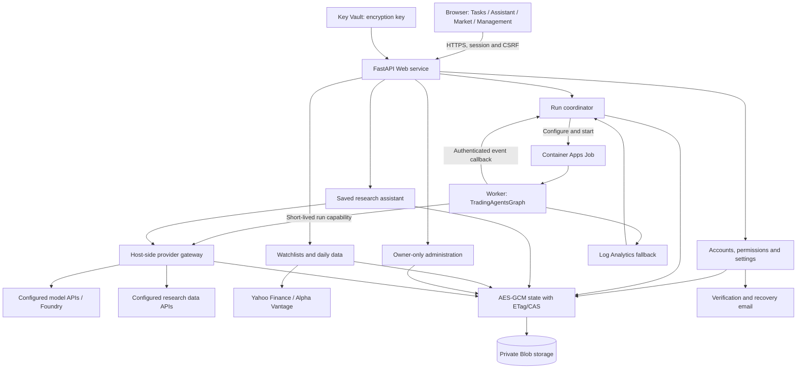
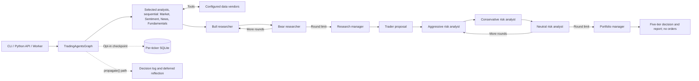

# TradingAgents Workbench

A research engine and self-hostable workbench built on [TauricResearch/TradingAgents](https://github.com/TauricResearch/TradingAgents). This is an independent, modified distribution, not an official or endorsed upstream release. The upstream source baseline is v0.4.0, commit `9dee508c44662702281a8dbaad1f7b42179b5ba7`.

The repository includes the research engine, CLI/Python entrypoints, browser application, Research Assistant, Market, owner-only Management, tests, build sources and infrastructure examples. It does not include a hosted service, provider access, user accounts, personal research, production deployment records or earlier private Git history.

**Research only:** output is a report and five-tier decision, not an order. There is no brokerage integration, simulated exchange or portfolio backtest engine. Nothing here is financial, investment or trading advice.

## Workspaces

| Workspace | Responsibility |
| --- | --- |
| Research Tasks | Stock, ETF and crypto research; reports, stage/tool events, history, usage and exports |
| Research Assistant | Account-scoped saved conversations, with bounded read-only context from the same account's research |
| Market | Account-scoped watchlists, source-labelled daily quotes/OHLCV and line/candlestick charts |
| Management | Fixed owner only: accounts, feature permissions, reversible disable, bounded usage and audit |

The native JavaScript interface includes Chinese/English localization, themes, appearance controls, responsive layouts, Lucide icons, Three.js scenes and self-hosted Lightweight Charts. Progress is stage/event streaming, not provider-token streaming. A synthetic interface prototype is retained as a build source; it is not a live login or a production account.

## Architecture

### Hosted Application



The Job uses an Azure manual trigger, but the Web coordinator starts it automatically after an authorized submission. The hosted Worker receives run configuration and a scoped capability, not provider keys or Foundry tokens. The gateway checks account/run permissions, model/provider configuration, request schema and destination before dispatch. Assistant and Market run in the Web process, not a research Job.

### Research Engine



| Source area | Responsibility |
| --- | --- |
| `cli/`, `main.py`, configuration | Local entrypoints, defaults and environment overrides |
| `tradingagents/graph/`, `tradingagents/agents/` | LangGraph state/routing, analyst roles, debates and report decisions |
| `tradingagents/dataflows/` | Prices, indicators, news, social, macro, ETF identity and prediction-market adapters |
| `tradingagents/llm_clients/` | Provider registry and OpenAI-compatible, Anthropic, Google, Azure and optional Bedrock adapters |
| `tradingagents/workbench/` | Local/hosted APIs, authentication, settings, execution, gateway, state and application services |
| `tradingagents/workbench/static/`, `scripts/` | Browser modules, visual build sources, charts and build/deployment examples |
| `infra/`, `tests/` | Infrastructure templates and Python/Node validation |

## Run Locally

Python 3.10+ is required; Python 3.12 is a practical default. Install the provider dependencies and configure your own credentials. Research and model calls may incur charges.

```bash
git clone https://github.com/easonwangzk/TradingAgents-Workbench.git
cd TradingAgents-Workbench
python -m venv .venv
```

Activate the environment, then:

```bash
pip install -e ".[dev]"
cp .env.example .env
python -m cli.main --help
tradingagents
```

On PowerShell, use `Copy-Item .env.example .env` instead of `cp`. Keep real credentials in the local environment or a secret manager, never in committed examples.

The interactive CLI supports `tradingagents --checkpoint` and `tradingagents --clear-checkpoints`; there is no `analyze` subcommand. Python applications can call `TradingAgentsGraph.propagate()` directly.

### Browser And Hosted Modes

- **Local browser:** install `.[workbench,dev]`, authenticate with Azure CLI, provision your own Job and supply `.local-run/workbench/deployment.json`, then run `scripts/start-workbench.ps1`. Starting the UI alone does not provision a research backend.
- **Email-hosted:** install `.[public-workbench,dev]` and configure your own Web/Worker identities, storage, encryption key, mail and providers. Account permissions are checked at API/service and provider-dispatch boundaries.
- **Legacy Entra/OIDC:** a separate delegated-credential runtime remains in the source; it is not the email runtime.

See [self-hosting and configuration](docs/self-hosting.md). All bundled installation identifiers and deployment endpoints are examples, not reusable access to an existing installation. The reserved owner address is `owner@example.com`; replace it consistently for your own installation before initializing accounts. Do not edit an existing installation's owner identity without a separate migration plan.

## Build And Test

```bash
pip install -e ".[public-workbench,dev]"
python -m pytest tests -q
python -m ruff check .
```

Frontend validation requires Node 20.19+ and uses the lockfile:

```bash
cd tradingagents/workbench/static
npm ci
npm run check
npm run test:all
npm run build
npm run build:market
```

The build sources, including the synthetic prototype, are included. Do not package dependency directories, local credentials or deployment receipts with the source.

## Limits And Safety

- **Not point-in-time safe:** current fundamentals/overview and Polymarket data are not historical snapshots. Fiscal period-end filtering is not publication-date filtering. FRED supports vintage handling; Alpha Vantage macro is current-date-only. A historical date does not make all inputs backtest-safe.
- Selected analysts run sequentially. LLM output remains nondeterministic; no return or performance claim is made.
- Decision-memory hooks belong to the Python `propagate()` path; the CLI currently streams the graph directly. Deferred stock/benchmark returns may use unaligned date endpoints. Worker filesystem memory is not account-scoped durable hosted storage.
- The shared model allowance in the example implementation is $300 per UTC month. It is not an Azure invoice cap and excludes hosting, networking, email, data vendors, BYOK and outside calls. Conversation/message limits are not recurring per-user spending quotas. Review signup access, per-account quotas and ingress throttling before offering a public service.
- Assistant history/context, market watchlists and monitoring retention are bounded. Admin usage is not a billing ledger. Market data is daily/non-realtime and subject to provider terms and entitlements.
- Example model/pricing configuration requires independent review of deployment names, provider availability, rates, limits and expiry. Do not assume example values are current or verified for your installation.
- CLI tests and mocked contract tests are not proof of a deployed system. Infrastructure/operator commands create or change resources and are not smoke tests.

## License And Attribution

The upstream project and this modified distribution use [Apache-2.0](LICENSE), subject to retained third-party notices. See [NOTICE](NOTICE) for provenance and modification notices, and [THIRD_PARTY_NOTICES.md](THIRD_PARTY_NOTICES.md) for redistributed frontend dependencies and artwork attribution. Names and trademarks belong to their respective owners; no endorsement is implied.

Please cite the upstream research when using the framework:

```bibtex
@misc{xiao2025tradingagentsmultiagentsllmfinancial,
  title={TradingAgents: Multi-Agents LLM Financial Trading Framework},
  author={Yijia Xiao and Edward Sun and Di Luo and Wei Wang},
  year={2025},
  eprint={2412.20138},
  archivePrefix={arXiv},
  primaryClass={q-fin.TR},
  url={https://arxiv.org/abs/2412.20138}
}
```